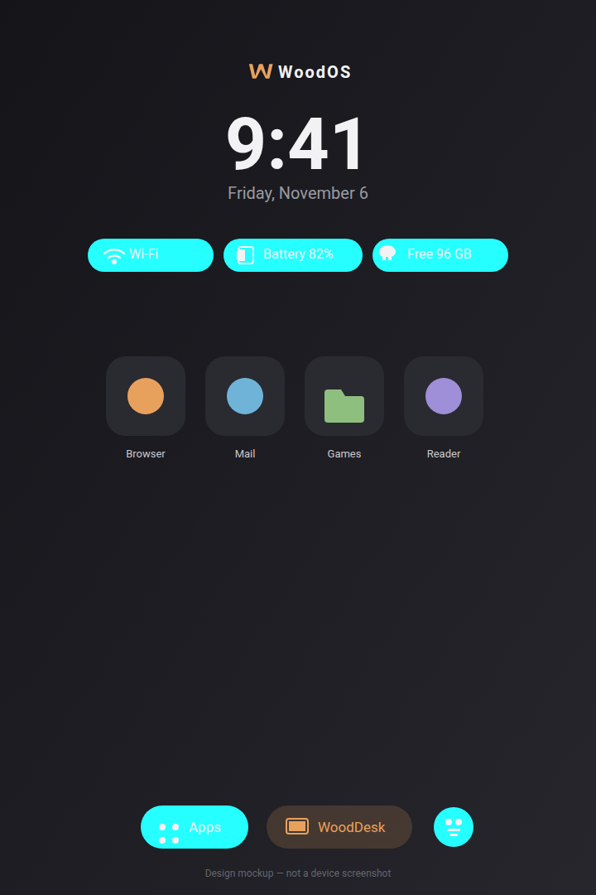
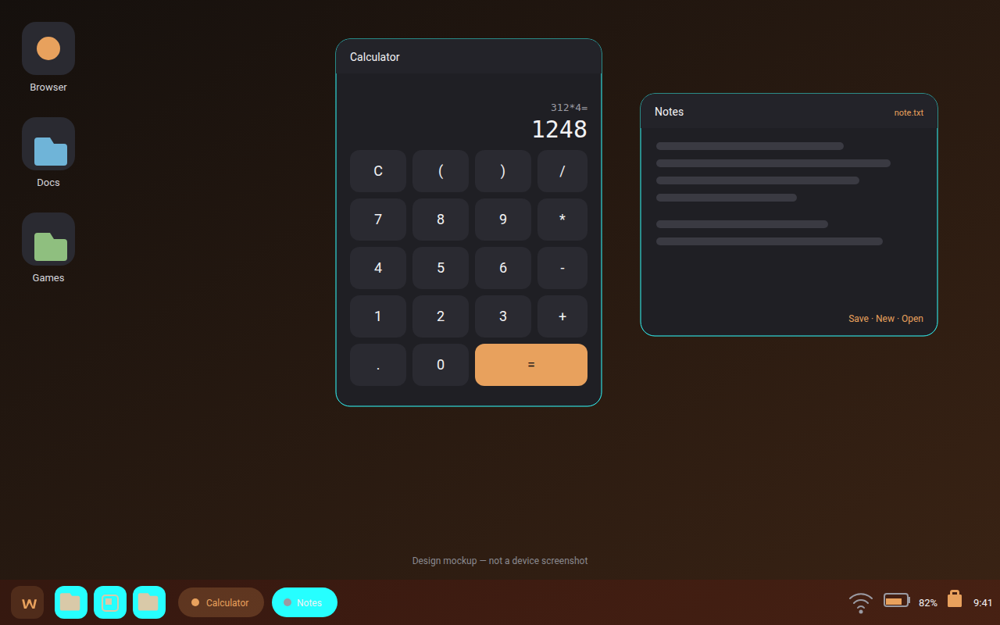

# WoodOS

**WoodOS is a lightweight, minimalist Android tablet experience featuring WoodDesk, a custom desktop environment for multitasking and productivity.**

WoodOS is a real, installable Android launcher app. It replaces your tablet's home screen with a clean, dark, fast interface of its own, and adds **WoodDesk** — a desktop-style environment with a taskbar, start menu and floating windows. No root access, no firmware replacement, no vendor-specific APIs: everything is built on public Android APIs.

   

---

## Highlights

### WoodOS Home
- Minimalist dark home screen with clock, date and the WoodOS mark
- Status chips: Wi-Fi, battery, storage and notification count
- Favorites grid with drag-and-drop rearranging and folders
- App drawer with search and a "recently opened" row
- Hide apps, change wallpaper (built-in gradients or your own image), accent colors, icon shape and size
- Portrait and landscape support

### WoodDesk
- Desktop environment with wallpaper, taskbar, start menu and desktop shortcuts
- **Floating windows** for the built-in apps: drag, resize, minimize, maximize, close, Alt+Tab window switching
- Built-in window apps: Notes, Calculator, Files, System info
- Start menu with search, favorites, all apps, settings and power options
- System tray with Wi-Fi state, battery, notification bell and clock
- Keyboard and mouse friendly: Bluetooth/USB keyboards and mice work, with shortcuts (Alt+Tab, Esc, Alt+F4, Meta key opens the start menu)
- External display support through Android's `Presentation` API
- Third-party apps open through Android's own multi-window support — on devices that support freeform windowing they launch in desktop-style windows; otherwise they open full-screen (see [Honest limitations](#honest-limitations))

### Performance
- **~115 KB release APK**, no third-party runtime dependencies — pure Android framework widgets
- No background services; the optional notification listener only runs while the system binds it
- Clocks update on the system `TIME_TICK` broadcast instead of timers
- Icons cached in a small `LruCache`; wallpapers are runtime-drawn gradients (no bitmap assets)
- Live memory measurements in Settings → Performance

## Screenshots

The images below are design mockups (SVG). Real device screenshots are welcome as pull requests.

| WoodOS Home | WoodDesk |
|---|---|
|  |  |

## Install

See [INSTALL.md](INSTALL.md) for full instructions, including how to make WoodOS your default launcher, how to activate WoodDesk, and how to return to your original launcher.

Quick start:

1. Download `WoodOS-release.apk` (or `WoodOS-debug.apk`) from the latest [GitHub Release](../../releases) or from the Actions artifacts
2. Open it on your Android 8.0+ tablet and allow "Install unknown apps" for your browser/file manager
3. Press Home and choose WoodOS as your launcher
4. Tap **WoodDesk** on the home bar to enter the desktop environment

## Build

See [BUILDING.md](BUILDING.md). In short:

```bash
git clone https://github.com/<you>/WoodOS.git
cd WoodOS
./gradlew assembleDebug
# APK: app/build/outputs/apk/debug/WoodOS-debug.apk
```

## Architecture

One lean application module with clearly separated packages:

| Package | Responsibility |
|---|---|
| `com.woodos.home` | WoodOS launcher home screen |
| `com.woodos.desk` | WoodDesk desktop environment, window management, built-in apps |
| `com.woodos.settings` | WoodOS settings |
| `com.woodos.apps` | Application manager (loader, icon cache, favorites model) |
| `com.woodos.core` | Shared core: prefs, theming, wallpapers, device info |
| `com.woodos.notifications` | Optional notification listener |
| `com.woodos.perf` | Performance monitoring |

## Version

Current version: **1.0.0** (versionCode 1). See [CHANGELOG.md](CHANGELOG.md).

## Honest limitations

WoodOS is a launcher app and does not pretend to be an OS firmware replacement:

- It cannot power off or restart the device (Android does not allow it) — the power options menu explains this and offers Exit / Home / System settings instead
- True desktop-style windows for **third-party** apps require the device to support freeform window management (`FEATURE_FREEFORM_WINDOW_MANAGEMENT`). WoodDesk checks for it and uses launch-bounds windowing when available; otherwise other apps open full-screen. The built-in WoodOS apps (Notes, Calculator, Files, System info) always run in real WoodDesk windows
- Reading the Wi-Fi network name requires location permission; WoodOS shows the connection state and signal without it
- WoodDesk's taskbar can list and switch WoodOS windows; it cannot embed or minimize arbitrary third-party apps

## License

MIT — see [LICENSE](LICENSE).
